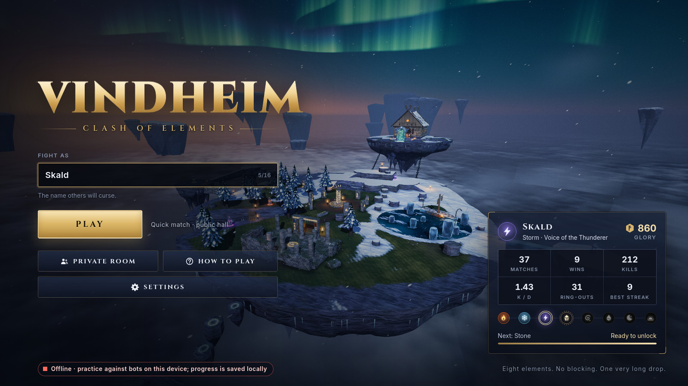
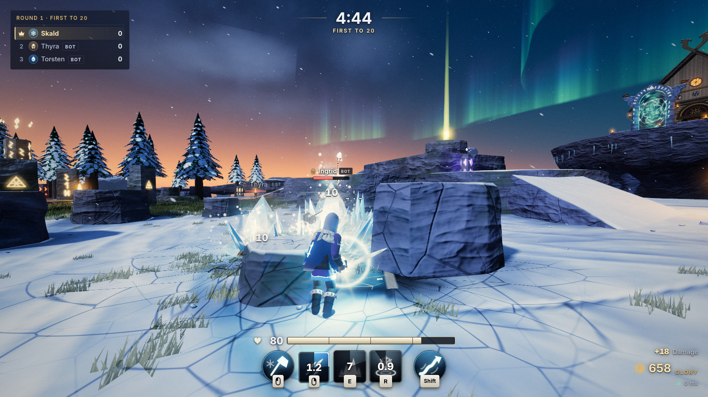
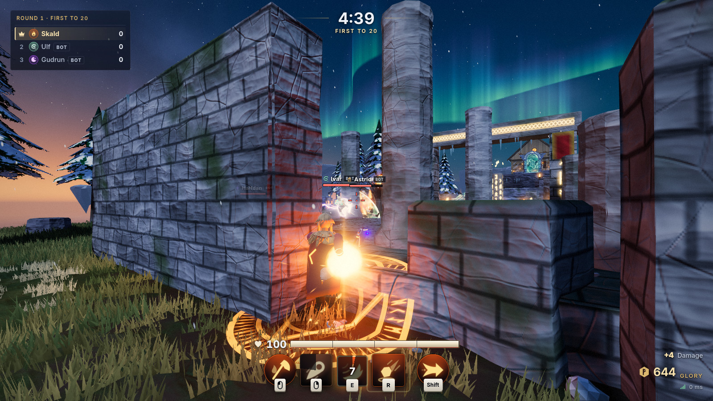
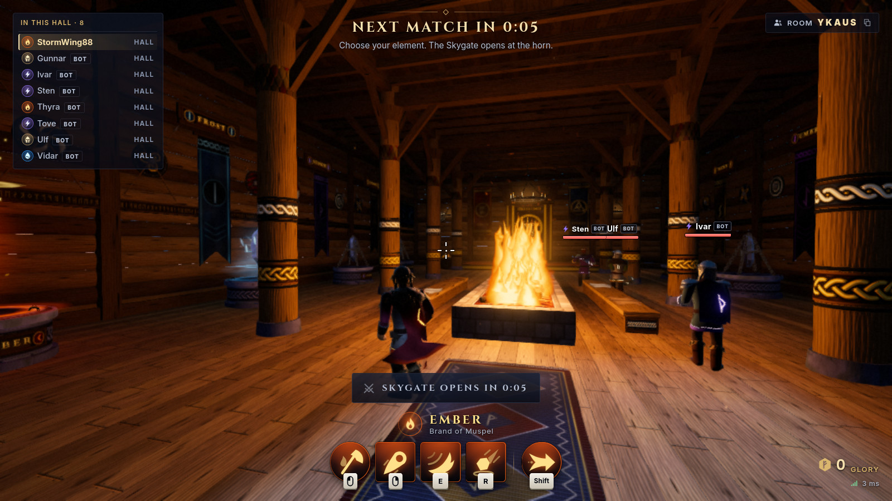
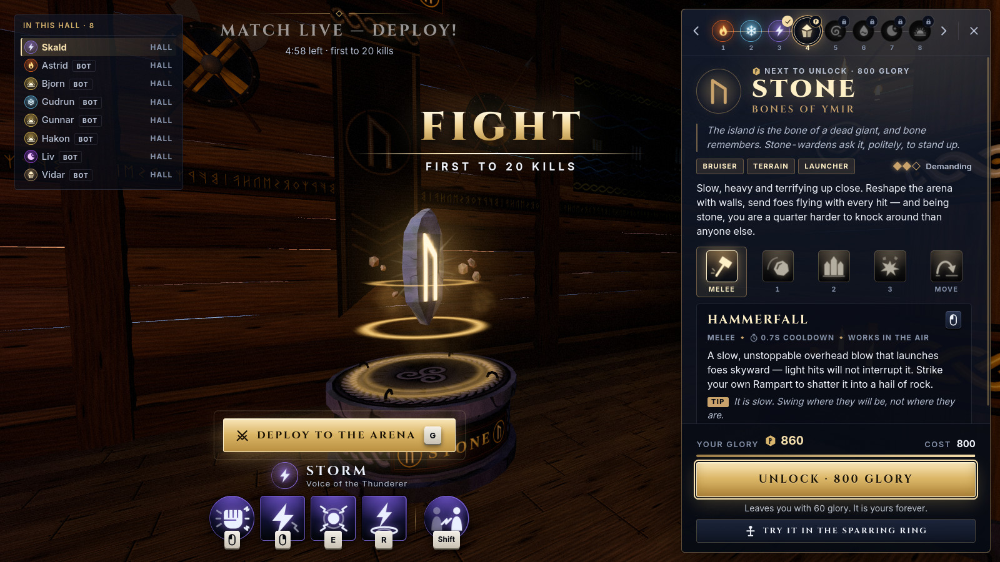
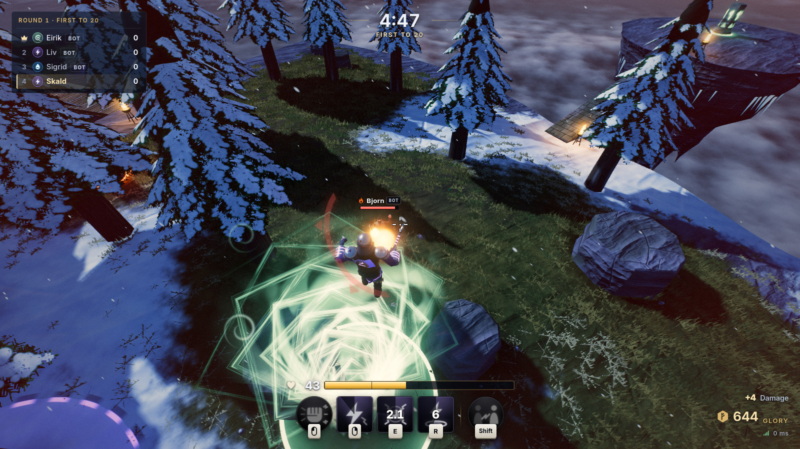
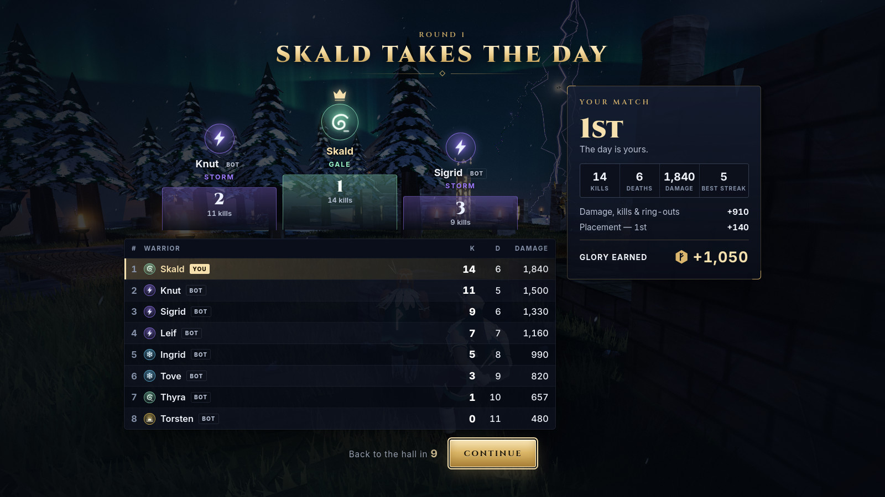
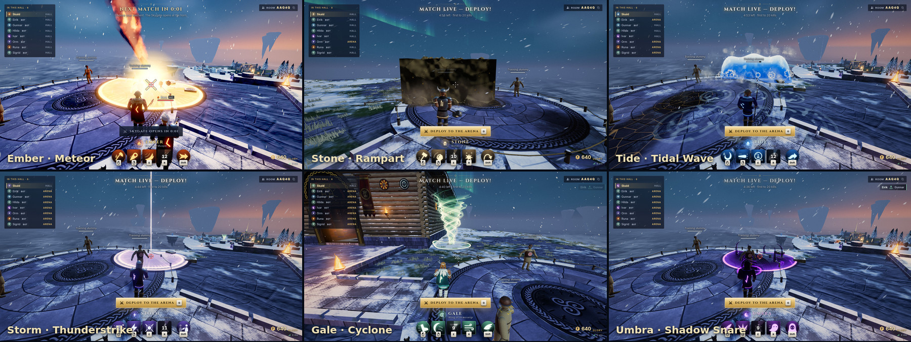
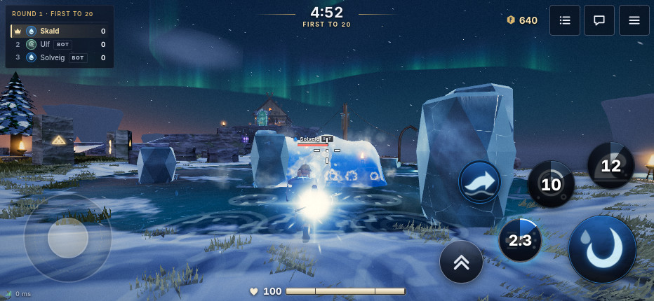

# Vindheim — Clash of Elements

A multiplayer 3D elemental arena fighter for desktop and mobile browsers.

A shard of the old world floats above an endless sea of cloud. Gather in the firelit Hearth-Hall,
take up one of eight elemental disciplines, step through the Skygate and fight a free-for-all where
**nothing can be blocked** — every clean hit staggers, launches or knocks down, and the abyss is
always one mistake away.



| | |
|---|---|
|  |  |
|  |  |
|  |  |



<p align="center"><br><em>The same game on a phone, with touch controls.</em></p>

## Features

- **Eight elements that play like eight characters** — Ember, Frost, Storm, Stone, Gale, Tide,
  Umbra and Dawn. Each has a committed melee strike, three elemental attacks and one signature
  movement ability: projectiles, beams, delayed strikes, traps, walls, pulls, bubbles, stealth…
- **Physical, readable combat** — no blocking or parrying. Light hits flinch, heavy hits launch
  and knock down, knockback grows as health drops, and a fall into the cloud sea is death. Wind-ups
  are tells, ground attacks are drawn on the ground, and every hit lands with hit-stop, shake,
  impact frames, damage numbers and layered sound.
- **A place, not a menu** — walk the hall, study the pedestal gallery, try any element on the
  training thralls in the sparring ring, then walk through the Skygate (or leap off the island)
  to drop into the arena.
- **A floating Norse sky-island** — a stone circle, rocky highlands with knife-edge ledges, a frozen
  lake and a wrecked longship, a ruined temple, a bridged chasm and four risky outlying islets,
  under aurora, drifting snow, blizzards and distant thunderstorms that every player sees together.
- **Drop-in multiplayer** — public rooms that are always populated (bots that aim, lead, dodge,
  chase, retreat, recover from the edge and use their kit), private rooms joined by a five-letter
  code or invite link, chat, a live leaderboard, kill feed, announcer and match results.
- **Progression that sticks** — glory for every hit and kill, an unlock ladder of elements, lifetime
  statistics, settings and identity carried across sessions.
- **Desktop and phone** — keyboard + mouse, gamepad and full touch controls, an interface that
  scales from a phone to 4K, onboarding hints, and accessibility options (reduce flashes, reduce
  motion, screen-shake scale, colour-blind-safe cues, high contrast, interface scale, rebindable keys).
- **No downloads, no asset files** — every model, texture, effect, sound and note of the adaptive
  score is generated in code. The whole game is under half a megabyte of gzipped JavaScript.
- **Plays offline too** — if no server can be reached the same simulation runs in the page, so the
  static build alone is a complete single-player practice game against bots.

## Quick start

Requires Node.js 20 or newer.

```bash
npm install
npm run dev          # game server on :8787 + Vite dev client on http://localhost:5173
```

Open <http://localhost:5173>. Open it in a second window (or on your phone, using your machine's
LAN address) to fight yourself.

Production build:

```bash
npm run build        # client -> dist/client, server -> dist/server
npm start            # serves the game and the WebSocket on http://localhost:8787
```

## How to play

| | Keyboard & mouse | Gamepad | Touch |
|---|---|---|---|
| Move | `W` `A` `S` `D` | left stick | left stick |
| Look / aim | mouse | right stick | drag the right side |
| Jump | `Space` | A | jump button |
| Melee strike | left mouse | RT | large button |
| Elemental attacks | right mouse / `Q`, `E`, `R` | LT, RB, LB | three ability buttons |
| Movement ability | `Shift` | B | movement button |
| Study a pedestal | `F` | X | prompt button |
| Deploy to the arena | `G` (or walk through the Skygate) | Y | prompt button |
| Return to the hall | hold `H` | D-pad down | menu |
| Scoreboard / chat / menu | `Tab` / `Enter` / `Esc` | Back / — / Start | top buttons |

Every key can be rebound in **Settings → Controls**.

**The rules in six lines**

1. 100 health. Nothing can be blocked — dodge, jump, out-space, interrupt.
2. Light hits flinch. Heavy hits launch you: land within half a second and you are knocked down;
   tap jump just before landing to roll out of it.
3. Stay airborne longer than that and you right yourself — your one chance to steer or use your
   movement ability to get back to solid ground.
4. Knockback grows as your health drops. The cloud sea kills, and the last one to hit you gets the kill.
5. Health runes appear on the dangerous spots: the islets, the peak, the wreck.
6. Matches last five minutes or until someone reaches twenty kills. Glory earned from hits, kills,
   ring-outs and placement unlocks the next element in the hall.

## The elements

| Element | Role | Signature movement | Unlock |
|---|---|---|---|
| **Ember** — Brand of Muspel | All-rounder · zoning · burn | *Cinder Dash* — dash leaving a trail of fire | free |
| **Frost** — Breath of Niflheim | Control · traps · freeze | *Glacier Glide* — surf a steerable ribbon of ice | 250 |
| **Storm** — Voice of the Thunderer | Precision · tempo · stun | *Thunderstep* — teleport where you aim | 500 |
| **Stone** — Bones of Ymir | Bruiser · terrain · launcher | *Seismic Leap* — vault and crash down | 800 |
| **Gale** — Wing of Hræsvelgr | Ring-outs · mobility | *Zephyr Soar* — launch upward and glide, even mid-air | 1150 |
| **Tide** — Daughter of Rán | Displacement · setups | *Riptide Surge* — become a wave and bowl through foes | 1550 |
| **Umbra** — Shade of Náströnd | Assassin · stealth · traps | *Shadowmeld* — vanish and move faster | 2000 |
| **Dawn** — Spear of Sól | Marksman · high risk | *Lightray* — streak in a straight line in any direction | 2500 |

Every ability — numbers, timings, descriptions — lives in [`shared/elements.ts`](shared/elements.ts).
A few favourite interactions: Storm's *Arc Bolt* overloads its own *Ball Lightning*; Stone's
*Hammerfall* shatters its own *Rampart* into a hail of rock; a foe frozen by Frost or floating in
Tide's *Bubble Prison* takes bonus damage from the hit that frees them; Umbra's *Dusk Fang* is a
guaranteed knockdown from behind or from stealth.

## Architecture

```
shared/           deterministic game logic used by both sides
  world.ts          the islands: analytic terrain + collider list (physics AND art source of truth)
  elements.ts       the roster: every ability as data
  sim/player.ts     fighter step: movement, action state machine, movement abilities
  sim/game.ts       authoritative room simulation: hits, projectiles, zones, traps, scoring, match loop
  sim/bots.ts       bot brains (perception, aim, dodging, edge recovery, ability use)
  sim/nav.ts        navigation grid discovered with the real physics queries + A*
  net/              wire protocol, lobby (sessions, matchmaking, rooms, persistence glue)
server/           Node: static file server + WebSocket + JSON profile store
client/src/
  app.ts            the loop; wires everything below together
  core/             networking (with offline fallback), prediction/interpolation, input, camera
  render/env/       terrain, props, sky, clouds, aurora, weather, lighting, post-processing, the hall
  render/char/      procedural skinned characters and procedural animation
  render/vfx/       pooled particles, trails, beams, decals and every ability's effects
  audio/            synthesised spatial SFX, ambience and the adaptive score (Web Audio)
  ui/               DOM interface: title, hall gallery, HUD, menus, settings, touch controls
tests/            vitest suites for the world, physics, combat rules, networking, prediction and bots
tools/            balance harness, headless screenshot helper
```

**Netcode.** The server simulates every room at 60 Hz and sends snapshots at 30 Hz. The client
predicts its own fighter with the very same `stepPlayer` function and reconciles by replaying
unacknowledged inputs; other fighters are interpolated ~100 ms in the past; projectiles and zones
are replicated as spawn/despawn events and simulated locally in between. Instant attacks are
lag-compensated against a short position history. Bots are ordinary fighters whose input is
written by a brain instead of a socket, so they obey exactly the same rules as people.

More detail, including the art direction and the entity catalogue, in [`docs/DESIGN.md`](docs/DESIGN.md).

## Testing

```bash
npm test             # vitest: world, physics, combat rules, protocol, lobby, prediction, bots
npm run typecheck
npx tsx tools/balance.ts 12 0.7   # bot-vs-bot balance report (12 matches, skill 0.7)
```

Each presentation subsystem also has a standalone harness page under `client/dev/` (served by
`npm run dev:client`), e.g. `/dev/env.html`, `/dev/char.html`, `/dev/vfx.html`, `/dev/audio.html`,
`/dev/ui.html`, and `/dev/core.html` which runs the real game loop with debug visuals that show
exactly what the physics sees.

## Deploying

Vindheim is one Node process that serves the built client and the WebSocket on the same port.

```bash
docker build -t vindheim .
docker run -p 8787:8787 -v vindheim-data:/app/data vindheim
```

| Variable | Default | Meaning |
|---|---|---|
| `PORT` | `8787` | HTTP + WebSocket port |
| `HOST` | `0.0.0.0` | interface to bind |
| `DATA_DIR` | `./data` | where `profiles.json` is kept — mount a volume here |
| `CLIENT_DIR` | `./dist/client` | built client to serve |
| `VITE_SERVER_URL` | same origin `/ws` | build-time: point the client at a server on another host (`wss://…/ws`) |

Example configs are included for Fly.io ([`fly.toml`](fly.toml)) and Render ([`render.yaml`](render.yaml)).
Rooms live in memory, so run a **single instance** and put it behind TLS (browsers require `wss://`
on `https://` pages). `GET /healthz` is the health check; `GET /api/status` reports rooms and players.

**Static hosting.** `dist/client` can also be dropped on any static host (GitHub Pages, Netlify…).
With no server to talk to, the game switches to offline practice against bots automatically
(or immediately with `?offline=1`).

## Notes

- Progress is tied to a random token kept in the browser's local storage; clearing site data starts
  a new identity. Offline practice keeps its own separate, local profile.
- Bots are labelled as bots everywhere they appear.
- Chat is plain text, rate-limited and lightly filtered; it can be turned off in Settings.

Created in [T3 Code](https://t3.codes).
